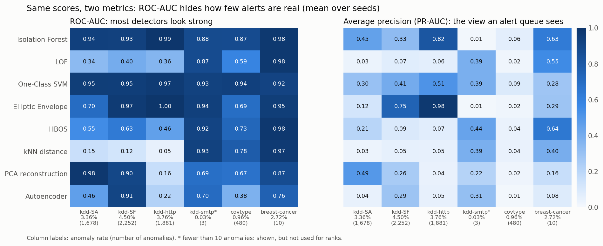
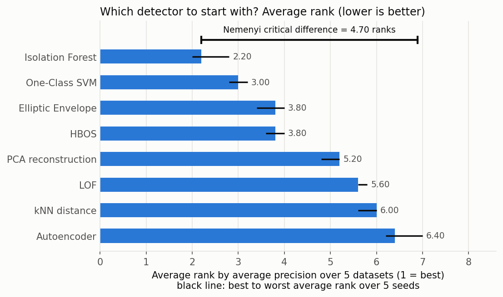
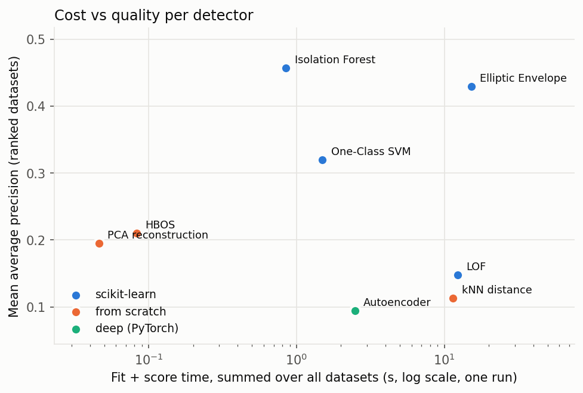
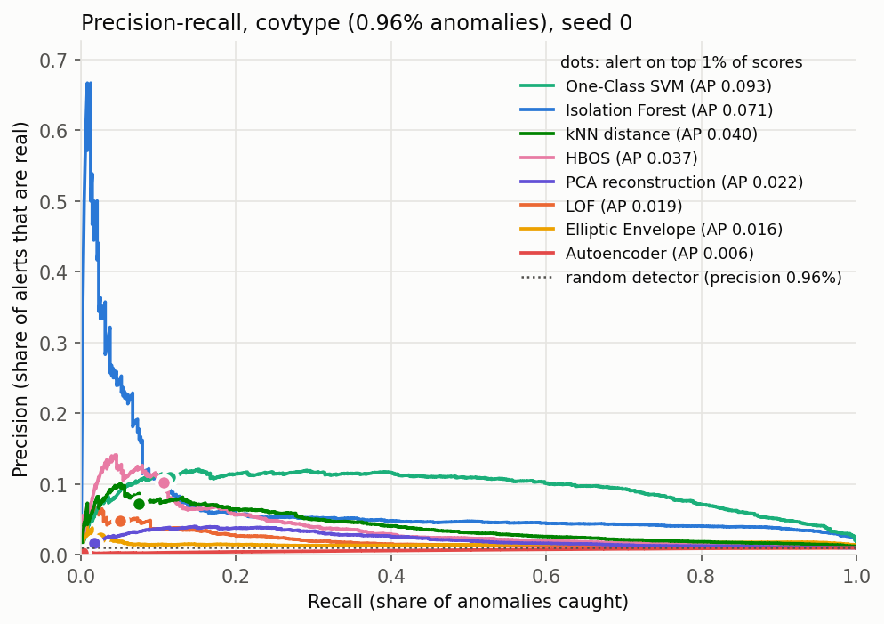

# Anomaly Detection Benchmark (`anomalybench`)

A reproducible benchmark of eight unsupervised anomaly detectors (scikit-learn, from-scratch
numpy and a PyTorch autoencoder) on network-intrusion and forest-cover data, scored the way an
alerting team needs it: precision-recall, rank stability across seeds, runtime, and what a fixed
alert budget actually buys.

[](https://github.com/faiqrasulov/anomaly-detection-benchmark/actions/workflows/ci.yml)

[](LICENSE)

## Key results

All numbers come from `make run` (about 3 minutes on a laptop CPU; peak RAM 498 MB for the
benchmark, 763 MB in the one-time data parse) and are stored in
[`reports/metrics.json`](reports/metrics.json); every table is in
[`reports/results.md`](reports/results.md).

- **Isolation Forest is the best default, but no detector wins everywhere.** Average
  average-precision (AP) rank 2.20 out of 8 over five datasets (2.00 to 2.80 across five seeds),
  mean AP 0.457, and 0.85 s of compute for all six datasets together. Yet it has the highest mean
  AP on none of them: the per-dataset winners are PCA reconstruction, Elliptic Envelope (twice),
  the One-Class SVM and HBOS. It wins by never failing badly.
- **ROC-AUC flatters.** On forest cover (0.96% anomalies) the One-Class SVM scores ROC-AUC 0.935
  but AP 0.091. Alerting on the top 1% of scores, the best detectors are right about **1 alert
  in 10** and catch about 10% of the anomalies.
- **Five datasets cannot separate eight detectors.** The Iman-Davenport test rejects "all
  detectors are equal" (p = 0.041), but the Nemenyi critical difference is 4.70 ranks, larger than
  the gap between the best and the worst detector (2.20 vs 6.40).
- **KDD Cup 99 duplicates decide the ranking.** 69-98% of attack rows are exact copies of another
  row (10-34% of normal rows), so attacks form dense clusters and kNN distance scores *below
  random* (ROC-AUC 0.050-0.154 on three KDD subsets). After de-duplication the autoencoder goes
  from AP 0.043 to 0.993 on `http`, and Isolation Forest from 0.422 to 0.882 on `SA`.
- **`contamination` is a threshold, not a model setting.** Isolation Forest's default
  `contamination="auto"` flags 14.0% of the forest-cover rows (true rate 0.96%), with 4.3%
  precision; AP is 0.0713 for every value. The One-Class SVM's `nu`, in contrast, changes the
  model: AP ranges from 0.069 to 0.117.



## Problem & why it matters

Fraud, intrusion and equipment-fault detection rarely come with labels: attacks are new, fraud
adapts, and failures are rare enough that nobody has a labelled history of them. Teams therefore
start with *unsupervised* detectors that score how unusual each record is, and a person
investigates the highest scores.

Two decisions follow, and both are usually made on weak evidence:

1. **Which detector?** Papers and vendor blogs report ROC-AUC. With 1% anomalies, a detector can
   reach ROC-AUC 0.93 while 9 of every 10 alerts it raises are false. What an analyst feels is
   precision at the top of the list, i.e. average precision (AP) and precision at a budget.
2. **Where to put the threshold?** Libraries ask for a `contamination` (expected anomaly share)
   that nobody knows. Getting it wrong silently multiplies the alert volume.

This repository benchmarks the common choices on public data with a fully unsupervised protocol,
reports the metrics that matter for alerting, checks how stable the conclusions are, and shows
how to turn scores into an alert budget.

## Approach

**Protocol (fully unsupervised).** Every detector is fitted on the unlabeled data, anomalies
included, and scores the same rows, as in Campos et al. (2016) and ADBench. Labels are used only
for evaluation. Hyperparameters are the usual defaults from each method's paper or library (for
the autoencoder, a small standard architecture), fixed before looking at results; tuning them on
labels would be cheating in a setting that has none.
Stochastic detectors run with five seeds (0-4); the data subsample is fixed, so seed variation
measures the detector's own randomness.

**Datasets.** Large datasets are subsampled to 50,000 rows (stratified, so the anomaly rate is
unchanged) to fit an 8 GB laptop and a few minutes of CPU.

| Dataset | Rows available | Rows used | Raw / model features | Anomalies | Rate | Anomaly = |
|---|---:|---:|---:|---:|---:|---|
| `kdd-SA` | 100,655 | 50,000 | 41 / 79 | 1,678 | 3.36% | attack (all normal traffic + 3,377 attacks drawn with replacement) |
| `kdd-SF` | 73,237 | 50,000 | 4 / 19 | 2,252 | 4.50% | attack, logged-in connections |
| `kdd-http` | 58,725 | 50,000 | 3 / 3 | 1,881 | 3.76% | attack, logged-in http |
| `kdd-smtp` | 9,571 | 9,571 | 3 / 3 | 3 | 0.03% | attack, logged-in smtp |
| `covtype` | 286,048 | 50,000 | 10 / 10 | 480 | 0.96% | cover type 4 (Cottonwood/Willow) vs type 2 (Lodgepole Pine) |
| `breast-cancer` | 367 | 367 | 30 / 30 | 10 | 2.72% | malignant (first 10 malignant + all 357 benign, Goldstein & Uchida 2016) |

The KDD subsets are scikit-learn's `fetch_kddcup99(subset=..., percent10=True)` definitions,
the forest-cover set follows Liu et al. (2008) with the 10 quantitative columns. **`kdd-smtp` has
only three anomalies**, so one anomaly moving a few places changes its AP by 0.3; it is reported
but excluded from the average ranks (rule fixed in advance: at least 10 anomalies).

**Preprocessing** (one function, never sees labels; a test checks that shuffling the labels leaves
the features unchanged):
- drop constant columns (4 in `kdd-SA`);
- `log1p` for non-negative columns with skewness > 2 (byte counts, durations, connection counts);
  without it, one 700 MB transfer sets the scale of a whole feature;
- robust scaling `(x - median) / (IQR / 1.349)`, falling back to the standard deviation for
  mostly-zero columns where the IQR is 0 (22 of the 34 numeric columns in `kdd-SA`). Robust
  statistics matter because the training data contains the anomalies;
- one-hot categoricals (`protocol_type`, `service`, `flag`) as plain 0/1. Scaling a rare
  category by its standard deviation would turn it into a value of 30+ that dominates every
  distance;
- float32 output.

**Detectors.** One interface (`fit`, `score_samples`, `train_scores`; higher = more anomalous).

| Detector | Implementation | Settings | Why it is here |
|---|---|---|---|
| Isolation Forest | scikit-learn | 100 trees, 256-row subsamples | The standard default (Liu et al. 2008) |
| LOF | scikit-learn | 20 neighbours | Density-based classic (Breunig et al. 2000) |
| One-Class SVM | scikit-learn | Nystroem (300 RBF components, gamma = 1/(d Var X)) + SGD one-class SVM, nu = 0.05 | Kernel method made linear-time; exact RBF OCSVM is quadratic in n |
| Elliptic Envelope | scikit-learn | Minimum Covariance Determinant, Mahalanobis distance | Robust Gaussian baseline (Rousseeuw & Van Driessen 1999) |
| HBOS | **from scratch** | sqrt(n) static bins per feature, smoothing 0.1 | Linear-time, assumes independent features (Goldstein & Dengel 2012) |
| kNN distance | **from scratch** (sklearn only for the neighbour search) | mean distance to 10 neighbours, self excluded | Distance-based classic (Angiulli & Pizzuti 2002) |
| PCA reconstruction | **from scratch** (numpy eigendecomposition) | components explaining 90% of variance; score = squared residual | Linear subspace baseline (Shyu et al. 2003) |
| Autoencoder | PyTorch, CPU | d-64-b-64-d MLP, b = min(8, d/2); Adam, 10 epochs | The usual "deep" option; trained on contaminated data, as it would be in practice |

**Metrics.** AP (the primary metric; a random detector scores the anomaly rate), ROC-AUC,
precision@n with n = number of true anomalies, and precision/recall when alerting on the top
0.5% / 1% / 2% / 5% of scores. Precision at k is **tie-aware**: KDD99 is full of identical rows
with identical scores, so the result is the expected value over a random order of the tied rows
(tested against enumeration of all orders), not whatever `argsort` happens to return. Detectors
are compared by average rank across datasets, with the Friedman test, the Iman-Davenport
correction and the Nemenyi critical difference (Demšar 2006). Fit and score times are wall-clock
on one machine (Apple M3, 2 threads).

**Engineering notes.**
- *Data loading under a memory cap.* scikit-learn's fetchers build Python object arrays on first
  load; the KDD parse was killed at a 1.2 GB cap. `anomalybench` downloads the same files (same
  mirror URLs, SHA-256 checked), parses them with pandas, reproduces the subset logic exactly, and
  caches each subset as a small `.npz`. Tests run scikit-learn's own fetchers on tiny local
  archives and check that both give identical arrays.
- *Two OpenMP runtimes.* In conda-based Python on macOS, importing PyTorch before scikit-learn
  loads two `libomp` copies, and the next parallel neighbour search segfaults or deadlocks. The
  package imports scikit-learn's OpenMP extensions first so PyTorch binds to the same runtime.
- BLAS, OpenMP and PyTorch threads are pinned (2 by default), so timings are reproducible and a
  second job on the same machine is not starved.

## Results

### Leaderboard

Average rank, mean AP and mean ROC-AUC over the five ranked datasets (rank 1 = best). Seed range:
best and worst average rank when the whole benchmark is re-run with a single seed. Time: one fit +
score of each dataset (median over seeds), summed over all six.

| Detector | Family | Avg AP rank | Seed range | Mean AP | Mean ROC-AUC | Time (s) |
|---|---|---:|---:|---:|---:|---:|
| Isolation Forest | scikit-learn | **2.20** | 2.0-2.8 | **0.457** | 0.943 | 0.85 |
| One-Class SVM | scikit-learn | 3.00 | 2.8-3.2 | 0.320 | **0.944** | 1.50 |
| Elliptic Envelope | scikit-learn | 3.80 | 3.4-4.0 | 0.430 | 0.862 | 15.25 |
| HBOS | from scratch | 3.80 | 3.6-4.0 | 0.210 | 0.670 | 0.08 |
| PCA reconstruction | from scratch | 5.20 | 4.8-5.2 | 0.195 | 0.715 | 0.05 |
| LOF | scikit-learn | 5.60 | 5.6-5.8 | 0.148 | 0.533 | 12.31 |
| kNN distance | from scratch | 6.00 | 5.6-6.0 | 0.113 | 0.415 | 11.48 |
| Autoencoder | PyTorch | 6.40 | 6.2-7.0 | 0.094 | 0.546 | 2.48 |

### Average precision per dataset

Mean ± standard deviation over five seeds for stochastic detectors (deterministic ones run once).
A random detector's AP equals the anomaly rate in the column header.

| Detector | kdd-SA (3.36%) | kdd-SF (4.50%) | kdd-http (3.76%) | kdd-smtp* (0.03%) | covtype (0.96%) | breast-cancer (2.72%) |
|---|---:|---:|---:|---:|---:|---:|
| Isolation Forest | 0.454 ± 0.021 | 0.332 ± 0.021 | 0.815 ± 0.037 | 0.006 ± 0.001 | 0.060 ± 0.016 | 0.626 ± 0.028 |
| One-Class SVM | 0.302 ± 0.039 | 0.408 ± 0.013 | 0.515 ± 0.005 | 0.389 ± 0.000 | **0.091 ± 0.006** | 0.281 ± 0.062 |
| Elliptic Envelope | 0.118 ± 0.118 | **0.749 ± 0.002** | **0.978 ± 0.000** | 0.006 ± 0.000 | 0.016 ± 0.000 | 0.288 ± 0.007 |
| HBOS | 0.205 | 0.095 | 0.070 | 0.445 | 0.037 | **0.642** |
| PCA reconstruction | **0.492** | 0.256 | 0.043 | 0.218 | 0.022 | 0.161 |
| LOF | 0.034 | 0.073 | 0.061 | 0.389 | 0.019 | 0.552 |
| kNN distance | 0.028 | 0.052 | 0.049 | 0.389 | 0.040 | 0.397 |
| Autoencoder | 0.045 ± 0.004 | 0.287 ± 0.071 | 0.049 ± 0.010 | 0.313 ± 0.110 | 0.007 ± 0.001 | 0.082 ± 0.009 |

\* three anomalies; not used for ranks. ROC-AUC and precision@n tables: [`reports/results.md`](reports/results.md).

How to read it:
- **ROC-AUC vs AP.** The heatmap at the top shows the same scores twice. Isolation Forest and the
  One-Class SVM have mean ROC-AUC 0.943 and 0.944, nearly identical, yet their mean AP differs by
  0.137 (0.457 vs 0.320). On `kdd-http` the One-Class SVM has ROC-AUC 0.967 but precision@n
  0.133: of the 1,881 highest-scored connections, only 13% are attacks.
- **Below-random neighbour methods on KDD.** kNN distance has ROC-AUC 0.154 / 0.121 / 0.050 on
  `kdd-SA` / `SF` / `http`, LOF 0.338 / 0.404 / 0.360. These methods assume anomalies are isolated;
  KDD attacks are bursts of near-identical connections (`kdd-http` has 1,881 attack rows but only
  59 distinct ones), so an attack's nearest neighbours are copies of itself at distance 0. On
  `covtype` and `breast-cancer`, where anomalies are not duplicated, the same methods are no
  longer below random (ROC-AUC 0.586-0.980).
- **Elliptic Envelope is all or nothing.** Best on the low-dimensional `kdd-SF` and `kdd-http`
  (AP 0.749 and 0.978), but on `kdd-SA` (79 mostly one-hot features) its AP is 0.118 ± 0.118 and
  its rank swings with the seed: the covariance of mostly-binary data is not full rank
  (scikit-learn warns on every run), so the Mahalanobis distance ignores whole directions.
- **Reconstruction only sees anomalies that leave the main directions of variation.** The rare
  tree species in `covtype` differ from the normal class mostly in elevation (3.75 robust
  standard deviations lower), and 97% of that shift lies inside the 7-dimensional subspace PCA
  keeps, so PCA and the autoencoder reconstruct them well (ROC-AUC 0.668 and 0.380). On `kdd-SA`
  only 20% of the shift lies inside PCA's 3-dimensional subspace, and there PCA has the best AP
  of all (0.492). The diagnostics table in [`reports/results.md`](reports/results.md) has this
  for every dataset.

### Is the ranking real? Statistics and seed stability



- Friedman test on AP ranks: chi2 = 13.40, p = 0.063; Iman-Davenport F = 2.48, p = 0.041. Evidence
  that the detectors are not all equal, but weak.
- Nemenyi critical difference at alpha = 0.05: **4.70 ranks**. The largest gap (Isolation Forest
  2.20 vs autoencoder 6.40) is 4.20, so **no pair of detectors is significantly different**. A
  benchmark with five datasets supports "Isolation Forest is a sensible first choice", not
  "Isolation Forest is better than LOF".
- Seeds matter less than datasets: Kendall's tau between the average-rank orderings of any two
  seeds is at least 0.889 (mean 0.967), and the best detector per dataset is the same under every
  seed except on `breast-cancer` (Isolation Forest or HBOS). The autoencoder is the least stable
  (mean AP standard deviation 0.034 over seeds; rank 6.2 to 7.0).

### Cost vs quality



The two cheapest detectors, HBOS (0.08 s for all datasets) and PCA (0.05 s), sit in the middle of
the ranking. Isolation Forest is the best and among the fastest. The slowest, Elliptic Envelope and
the neighbour methods (11-15 s; the neighbour methods spend most of it on the 79-feature
`kdd-SA`, Elliptic Envelope on `covtype`), buy no extra quality on average.

### From scores to alerts: budgets and the `contamination` trap



`covtype` was chosen in advance for this section: its 0.96% anomaly rate is typical for alerting,
and it is free of KDD99's duplicates. Precision (P) and recall (R) when alerting on a fixed share
of the highest scores, averaged over seeds:

| Detector | top 0.5% (250 alerts) | top 1% (500) | top 2% (1,000) | top 5% (2,500) |
|---|---:|---:|---:|---:|
| HBOS | P 0.11 / R 0.06 | P 0.10 / R 0.11 | P 0.07 / R 0.14 | P 0.05 / R 0.25 |
| One-Class SVM | P 0.07 / R 0.04 | P 0.10 / R 0.10 | P 0.11 / R 0.23 | P 0.11 / R 0.55 |
| Isolation Forest | P 0.14 / R 0.07 | P 0.09 / R 0.10 | P 0.07 / R 0.14 | P 0.05 / R 0.25 |
| kNN distance | P 0.10 / R 0.05 | P 0.07 / R 0.07 | P 0.07 / R 0.15 | P 0.05 / R 0.28 |
| LOF | P 0.06 / R 0.03 | P 0.05 / R 0.05 | P 0.04 / R 0.09 | P 0.03 / R 0.17 |
| Elliptic Envelope | P 0.03 / R 0.01 | P 0.02 / R 0.03 | P 0.02 / R 0.04 | P 0.01 / R 0.07 |
| PCA reconstruction | P 0.01 / R 0.00 | P 0.02 / R 0.02 | P 0.03 / R 0.07 | P 0.04 / R 0.19 |
| Autoencoder | P 0.00 / R 0.00 | P 0.00 / R 0.00 | P 0.00 / R 0.00 | P 0.00 / R 0.01 |

How to set a budget: start from what the team can investigate (say 500 cases), convert it to a
share of traffic (1%), and read the expected precision and recall at that share. Here a 1% budget
means about 50 true anomalies among 500 alerts and 90% of the anomalies missed; covering half of
them takes a 5% budget with the One-Class SVM, at 1 true alert in 9. The best detector also
depends on the budget: Isolation Forest is the most precise at 0.5%, the One-Class SVM from 2%.

The `contamination` parameter is not a substitute for that decision. Isolation Forest, seed 0:

| `contamination` | Flagged by `predict()` | Precision | Recall | AP |
|---|---:|---:|---:|---:|
| `"auto"` (default) | 6,998 (14.00%) | 0.043 | 0.633 | 0.0713 |
| 0.001 | 50 (0.10%) | 0.300 | 0.031 | 0.0713 |
| 0.01 (about the true rate) | 500 (1.00%) | 0.104 | 0.108 | 0.0713 |
| 0.05 | 2,500 (5.00%) | 0.053 | 0.277 | 0.0713 |
| 0.1 | 5,000 (10.00%) | 0.046 | 0.483 | 0.0713 |

It only moves the `predict()` threshold; the scores, AP and ROC-AUC never change. The default
`"auto"` raises nearly 15 alerts per true anomaly (6,998 for 480). For the One-Class SVM the
analogous `nu` is also the regulariser, so it changes the model itself: AP 0.069 (nu = 0.01), 0.093 (0.05),
0.107 (0.1), 0.117 (0.2), 0.081 (0.5). Choosing `nu` by AP would need labels.

### KDD Cup 99: how much do the duplicates matter?

Tavallaee et al. (2009) showed that most KDD99 records are duplicates. Re-running every detector
(seed 0) after keeping one copy of each identical (features, label) record:

| Detector | kdd-SA: with / without duplicates | kdd-SF | kdd-http |
|---|---:|---:|---:|
| Isolation Forest | 0.422 / **0.882** | 0.342 / **0.362** | 0.790 / 0.392 |
| One-Class SVM | 0.294 / 0.130 | 0.391 / 0.223 | 0.516 / 0.649 |
| Elliptic Envelope | 0.072 / 0.248 | 0.747 / 0.288 | 0.978 / 0.942 |
| HBOS | 0.205 / 0.553 | 0.095 / 0.166 | 0.070 / 0.431 |
| PCA reconstruction | 0.492 / 0.274 | 0.256 / 0.172 | 0.043 / 0.129 |
| LOF | 0.034 / 0.042 | 0.073 / 0.064 | 0.061 / 0.131 |
| kNN distance | 0.028 / 0.019 | 0.052 / 0.093 | 0.049 / 0.346 |
| Autoencoder | 0.042 / 0.045 | 0.196 / 0.236 | 0.043 / **0.993** |

De-duplication shrinks the attacks far more than the normal traffic (`kdd-http`: 1,881 to 59
attacks, anomaly rate 3.76% to 0.16%), so the AP values before and after are not on the same
scale; the *ordering* within each column is what changes. The winner moves from PCA to
Isolation Forest on `kdd-SA`, from Elliptic Envelope to Isolation Forest on `kdd-SF`, and from
Elliptic Envelope to the autoencoder on `kdd-http`. Any conclusion drawn from KDD99 says as much
about its duplication as about the detectors.

### The autoencoder's training length

AP of the autoencoder (seed 0) by number of epochs; the benchmark uses 10, fixed in advance:

| Dataset | 5 epochs | 10 | 25 | 50 |
|---|---:|---:|---:|---:|
| kdd-SA | 0.039 | 0.042 | 0.034 | 0.035 |
| kdd-SF | 0.173 | 0.196 | 0.371 | 0.548 |
| kdd-http | 0.039 | 0.043 | 0.072 | 0.260 |
| covtype | 0.008 | 0.006 | 0.006 | 0.007 |

Longer training helps on two datasets and does nothing on the other two. Without labels there is
no validation signal for when to stop, so in practice this choice is a guess.

### What did not work

- **The deep autoencoder** ranks last (6.40) and is the least stable across seeds. Trained on
  contaminated data, it reconstructs whatever is frequent, and in KDD the attacks are frequent
  (duplicated); once `kdd-http` is de-duplicated it becomes the best detector there.
- **Neighbour methods on bursty data**: LOF and kNN distance are worse than random on three KDD
  subsets.
- **Statistical separation**: with five usable datasets the benchmark cannot declare any
  detector significantly better than another.

## Lessons

- **Default to Isolation Forest, then check AP at your budget.** It had the best average rank,
  little seed sensitivity, under a second of compute here, and its `contamination` setting cannot
  hurt the ranking. Keep HBOS as a near-free second opinion (rank 3.80 at 0.08 s).
- **Report AP and precision at the alert budget, not ROC-AUC.** At a 1% anomaly rate, ROC-AUC
  0.93 coexisted with 1-in-10 precision.
- **Know what each detector assumes.** Neighbour methods assume isolated anomalies and fail on
  bursts (DoS attacks, bot traffic, repeated fraud attempts); reconstruction methods miss anomalies
  that are extreme along the main directions of variation; a robust Gaussian fits low-dimensional
  numeric data, not one-hot data. Matching the assumption to the data mattered more than the
  choice of library.
- **Deep learning did not pay off here.** The autoencoder only won once, on de-duplicated
  `kdd-http`, where anomalies are rare and unlike anything frequent. Its quality depends on a
  training length that cannot be tuned without labels.
- **Set thresholds from capacity, not from `contamination`.** Decide how many alerts a team can
  handle, convert to a share, and read precision and recall at that share. Re-fit and re-check
  the share as traffic changes.
- **Treat KDD99 numbers with suspicion.** It is simulated 1998 military-network traffic, mostly
  duplicate records and dominated by a few DoS attack types; `SA` even samples attacks with
  replacement. Its rankings changed when duplicates were removed, and its `smtp` subset (10%
  version) has only three attacks.

## Quickstart

```bash
git clone https://github.com/faiqrasulov/anomaly-detection-benchmark.git
cd anomaly-detection-benchmark
make install          # pip install -e ".[dev]" (PyTorch CPU is enough)
make run              # download (~13 MB) -> benchmark -> reports/metrics.json, results.md, figures
make test             # 65 tests, ~5 s, no network
```

`make run` accepts `THREADS=4` and `MEMCAP="..."`; the CLI has more options:

```bash
anomalybench run --max-rows 20000 --seeds 3 --datasets kdd-http covtype --detectors iforest hbos
```

```python
from anomalybench.registry import make_detector
from anomalybench.metrics import average_precision, budget_metrics

scores = make_detector("iforest", seed=0).fit_score(X)   # higher = more anomalous
budget_metrics(y, scores, fraction=0.01)                  # alerts, precision, recall at top 1%
```

## Project structure

```
src/anomalybench/
  data.py          download (SHA-256 checked), memory-light parsing, KDD99/CoverType subsets, cache
  preprocess.py    label-free preprocessing: log1p, robust scaling, one-hot, float32
  detectors.py     detector interface + scikit-learn wrappers (IF, LOF, OCSVM, Elliptic Envelope)
  scratch.py       HBOS, kNN distance, PCA reconstruction (numpy)
  autoencoder.py   MLP autoencoder (PyTorch)
  registry.py      detector names -> classes
  metrics.py       AP, ROC-AUC, tie-aware precision@k, alert budgets
  ranking.py       average ranks, Friedman / Iman-Davenport, Nemenyi CD, seed stability
  runner.py        runs every detector x dataset x seed, timing and summaries
  alerting.py      budget tables, contamination / nu study
  studies.py       KDD de-duplication and autoencoder-epochs studies
  pipeline.py      end-to-end run -> metrics.json, results.md, figures
  figures.py, report.py, cli.py
reports/           metrics.json, results.md and figures written by `make run`
tests/             65 pytest tests (references: scikit-learn fetchers and PCA, scipy, Demšar's tables)
```

## Limitations & next steps

- **Transductive protocol.** Detectors score the rows they were fitted on. In production a
  detector is fitted on a past window and scores new traffic; drift between the two is not
  measured here.
- **Default hyperparameters only**, by design. The two sensitivity studies (autoencoder epochs,
  One-Class SVM `nu`) show that some detectors would rank differently under other settings.
- **Five ranked datasets** give little statistical power. Next: the ODDS / ADBench collections and
  a modern intrusion dataset (NSL-KDD, CIC-IDS2017 or UNSW-NB15) in place of KDD99.
- **Subsampling and one machine.** Large datasets are capped at 50,000 rows; runtimes are from an
  Apple M3 with 2 threads and will differ elsewhere; compare them relative to each other.
- **Forest cover is a proxy.** "Rare tree species" stands in for a real fault or fraud signal.
- **Next steps:** score ensembles with rank normalisation, ECOD/COPOD, Deep SVDD, kNN with
  de-duplicated reference sets, and a time-ordered split for alert budgets.

## Data & references

Datasets (downloaded at run time into `data/`, never committed):
- **KDD Cup 1999 Data** (10% version), UCI Machine Learning Repository, CC BY 4.0. Stolfo, Fan,
  Lee, Prodromidis & Chan (1999). Subsets as defined by scikit-learn's `fetch_kddcup99`.
- **Covertype**, UCI Machine Learning Repository, CC BY 4.0. Blackard & Dean (1999). *Comparative
  accuracies of artificial neural networks and discriminant analysis in predicting forest cover
  types from cartographic variables.* Computers and Electronics in Agriculture 24(3).
- **Breast Cancer Wisconsin (Diagnostic)**, UCI Machine Learning Repository, CC BY 4.0 (copy
  bundled with scikit-learn). Street, Wolberg & Mangasarian (1993).

Methods and evaluation:
- Liu, Ting & Zhou (2008). *Isolation Forest.* ICDM.
- Breunig, Kriegel, Ng & Sander (2000). *LOF: identifying density-based local outliers.* SIGMOD.
- Schölkopf, Platt, Shawe-Taylor, Smola & Williamson (2001). *Estimating the support of a
  high-dimensional distribution.* Neural Computation 13(7).
- Williams & Seeger (2001). *Using the Nyström method to speed up kernel machines.* NeurIPS.
- Rousseeuw & Van Driessen (1999). *A fast algorithm for the minimum covariance determinant
  estimator.* Technometrics 41(3).
- Goldstein & Dengel (2012). *Histogram-based Outlier Score (HBOS).* KI-2012 poster track.
- Ramaswamy, Rastogi & Shim (2000). *Efficient algorithms for mining outliers from large data
  sets.* SIGMOD. Angiulli & Pizzuti (2002). *Fast outlier detection in high dimensional spaces.* PKDD.
- Shyu, Chen, Sarinnapakorn & Chang (2003). *A novel anomaly detection scheme based on principal
  component classifier.* ICDM workshop.
- Hawkins, He, Williams & Baxter (2002). *Outlier detection using replicator neural networks.* DaWaK.
- Tavallaee, Bagheri, Lu & Ghorbani (2009). *A detailed analysis of the KDD CUP 99 data set.*
  IEEE CISDA.
- Goldstein & Uchida (2016). *A comparative evaluation of unsupervised anomaly detection
  algorithms for multivariate data.* PLoS ONE 11(4).
- Campos et al. (2016). *On the evaluation of unsupervised outlier detection: measures, datasets,
  and an empirical study.* Data Mining and Knowledge Discovery 30(4).
- Han, Hu, Huang, Jiang & Zhao (2022). *ADBench: anomaly detection benchmark.* NeurIPS Datasets
  and Benchmarks.
- Saito & Rehmsmeier (2015). *The precision-recall plot is more informative than the ROC plot when
  evaluating binary classifiers on imbalanced datasets.* PLoS ONE 10(3).
- Demšar (2006). *Statistical comparisons of classifiers over multiple data sets.* JMLR 7.

## License

MIT, see [LICENSE](LICENSE).
